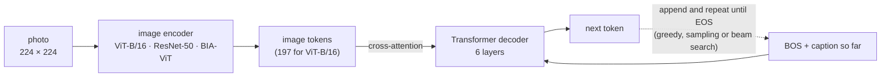

# BIA-IMG-Captioner

**Show it a photo, get back a sentence describing it.**

[](pyproject.toml)
[](https://pytorch.org)
[](https://huggingface.co/datasets/AnyModal/flickr30k)

An image-captioning model in plain PyTorch: an image encoder turns the photo
into a set of "image tokens", and a hand-written Transformer decoder writes the
caption one word piece at a time while attending to them. Three encoders are
available: a **pretrained ViT-B/16** (default), a **pretrained ResNet-50**, or
the project's own **BIA Vision Transformer trained from scratch**. Trains on a
CPU, one GPU, several GPUs or several machines.



> **No trained weights are published yet.** Train a model first (step 4
> below, or the Kaggle/Colab notebook); a checkpoint is then saved in
> `checkpoints/run/`.

## Quick start

```bash
# 1. install (Python >= 3.10)
python -m venv .venv
source .venv/bin/activate
pip install -e '.[dev]'          # see docs/training.md for GPU / CPU-only torch

# 2. check everything works (CPU, no network, ~1 min)
pytest

# 3. sanity check on real data: can the model memorise 8 images?
cap-train --overfit 8 --epochs 60 --batch-size 8 --lr 1e-3 --warmup-steps 5 \
          --eval-every 20 --log-every 5 --output-dir checkpoints/overfit

# 4. real training (1 GPU; pick the encoder with --encoder vit-b16 | resnet50 | bia-vit)
cap-train --output-dir checkpoints/run

# 5. use the trained model
cap-generate --checkpoint checkpoints/run/best.pt --image photo.jpg
cap-evaluate --checkpoint checkpoints/run/best.pt --split test        # BLEU-1..4
streamlit run app/streamlit_app.py -- --checkpoint checkpoints/run/best.pt   # pip install -e '.[app]'
```

## What changed from the first version

The first version (kept in [`legacy/`](legacy/README.md)) trained badly for
concrete reasons, all fixed here:

| Problem in v1 | Effect | Now |
|---|---|---|
| ViT encoder trained from scratch on 29k images | encoder learns little, generic captions | pretrained ViT-B/16 or ResNet-50 by default; the BIA-ViT is still available (`--encoder bia-vit`) |
| `zero_grad()` before every batch, `step()` every 25 | 24 of 25 batches' gradients thrown away | correct gradient accumulation (tested) |
| `max_iters = 20` with steps every 25 batches; 8 000-step warmup | the optimizer barely (or never) stepped | full epochs, 500-step warmup + cosine |
| attention module built itself (`self.ln = ResMHAtten(...)`) | the model could not be created | clean pre-norm blocks with fused attention |
| single-process loader, 5 encoder passes per image per epoch | slow, GPU mostly idle | parallel `DataLoader`, one pass per image with a random caption |

The full audit (model, generation, training, data, app) is in
[legacy/README.md](legacy/README.md).

## Documentation

| Guide | What is inside |
|-------|----------------|
| [notebooks/train_colab_kaggle.ipynb](notebooks/train_colab_kaggle.ipynb) | **Train on a free Kaggle or Colab GPU**: self-contained, same code, live loss / accuracy / BLEU dashboard |
| [docs/training.md](docs/training.md) | Choosing an encoder; CPU, one GPU, several GPUs or machines; resume; every flag; time estimates |
| [docs/inference.md](docs/inference.md) | Caption images (CLI, Python, web demo), beam search vs sampling, BLEU evaluation |
| [docs/testing.md](docs/testing.md) | Unit tests, the overfit sanity check on real data, what each test proves |
| [docs/architecture.md](docs/architecture.md) | How the encoders, decoder, loss and beam search work, with tensor shapes |
| [legacy/README.md](legacy/README.md) | What was wrong with the first version and why it trained badly |

## Repository layout

```
src/bia_captioner/     the package (read in this order)
  config.py            every hyperparameter: DataConfig, ModelConfig, TrainConfig
  tokenizer.py         GPT-2 BPE + a dedicated <|pad|>; sequences are <bos> caption <eos>
  data.py              Flickr30k dataset (random caption per image), transforms, collator
  model.py             encoders (ViT-B/16, ResNet-50, BIA-ViT) + Transformer decoder,
                       loss, greedy / sampling generate(), beam_search()
  metrics.py           corpus BLEU-1..4 (no extra dependency)
  train.py             training loop: AMP, grad accumulation, DDP, checkpoints, CLI
  generate.py          inference CLI: checkpoint + images -> captions
  evaluate.py          BLEU of a checkpoint on a held-out split
app/streamlit_app.py   web demo
notebooks/             Kaggle / Colab notebook (+ the script that builds it from src/)
tests/                 pytest suite (CPU only, offline)
docs/                  guides
legacy/                the original code, kept for reference, with an audit of its issues
pyproject.toml         dependencies and the cap-train / cap-generate / cap-evaluate commands
```

## Dataset

[Flickr30k](https://huggingface.co/datasets/AnyModal/flickr30k) with the
standard Karpathy splits: 29 000 train / 1 014 validation / 1 000 test photos,
5 human captions each (~4.3 GB, downloaded automatically on first run). We
validate on `validation` and keep `test` for the final BLEU.

## Status and next steps

- [x] Clean data pipeline, three encoders, decoder, training loop, inference
      and evaluation CLIs, web demo, tests
- [x] Single-GPU, multi-GPU and multi-node training (DDP)
- [x] End-to-end runs on real Flickr30k images (overfit sanity checks, see docs/testing.md)
- [ ] Full training run on GPU and test-split BLEU for each encoder
- [ ] CIDEr / METEOR (the usual captioning metrics besides BLEU)
- [ ] KV cache for faster generation
