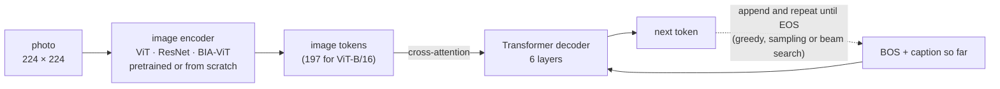
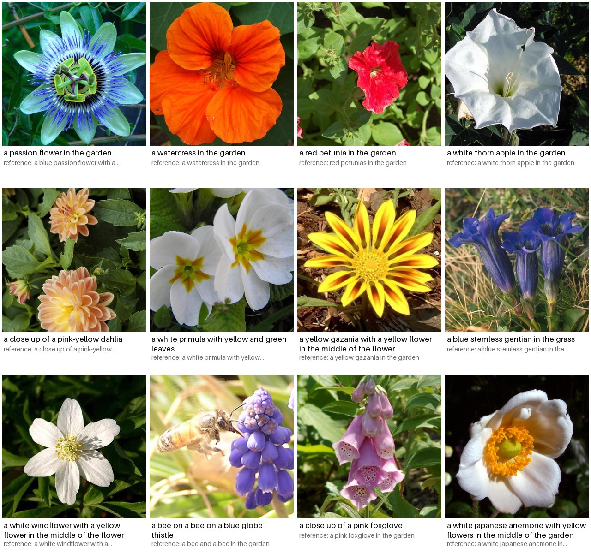
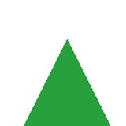
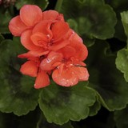
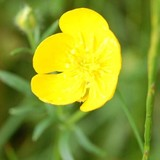

# Image Captioner

**Show it a photo, get back a sentence describing it.**

[](pyproject.toml)
[](https://pytorch.org)
[](docs/datasets.md)

An image-captioning model in plain PyTorch: an image encoder turns the photo
into a set of "image tokens", and a hand-written Transformer decoder writes the
caption one word piece at a time while attending to them. The encoder can be a
**Vision Transformer** or a **ResNet**, **pretrained or trained from
scratch**: the project's own BIA-ViT, any torchvision ViT / ResNet, or any
Hugging Face vision model (ImageNet-21k ViT, DINOv2, CLIP, ...). Trains on a
CPU, one GPU, several GPUs or several machines.





*Captions generated for **unseen test photos** (black) next to a reference
caption (grey). Model: frozen ImageNet ResNet-50 + a 16.6M-parameter decoder
trained for 4 epochs on the `flowers` dataset on a laptop CPU; test BLEU-4
47.7 (see [docs/testing.md](docs/testing.md#3-flowers-real-photos-quick-results)).*

> **No trained weights are published.** Train a model first (steps 3–5 below,
> or the Kaggle/Colab notebook); a checkpoint is then saved in `checkpoints/`.

## Quick start

```bash
# 1. install (Python >= 3.10)
python -m venv .venv
source .venv/bin/activate
pip install -e '.[dev]'          # see docs/training.md for GPU / CPU-only torch

# 2. unit tests and neural-network sanity checks (CPU, no network, ~3 min)
pytest

# 3. prove the architecture learns from pixels: synthetic shapes, no download, laptop CPU
cap-train --dataset shapes --encoder bia-vit --image-size 64 --patch-size 8 \
          --d-model 128 --heads 4 --layers 2 --encoder-layers 3 \
          --epochs 8 --lr 1e-3 --warmup-steps 100 --eval-every 250 --bleu-samples 200 \
          --output-dir checkpoints/shapes

# 4. sanity check on real photos: can the model memorise 8 of them?
cap-train --overfit 8 --epochs 60 --batch-size 8 --lr 1e-3 --warmup-steps 5 \
          --eval-every 20 --log-every 5 --output-dir checkpoints/overfit

# 5. real training (1 GPU)
cap-train --dataset flickr30k --encoder vit_b_16 --output-dir checkpoints/run

# 6. use the trained model
cap-generate --checkpoint checkpoints/run/best.pt --image photo.jpg
cap-evaluate --checkpoint checkpoints/run/best.pt --split test        # BLEU-1..4
streamlit run app/streamlit_app.py -- --checkpoint checkpoints/run/best.pt   # pip install -e '.[app]'
```

## Encoders: ViT or ResNet, pretrained or from scratch

| `--encoder` | Family | Default start | `--from-scratch` |
|---|---|---|---|
| `bia-vit` | the project's own Vision Transformer | from scratch | (always) |
| `vit_b_16` (default), `vit_b_32`, `vit_l_16`, `vit_l_32`, `vit_h_14` | torchvision ViT | ImageNet-1k weights | random init |
| `resnet18`, `resnet34`, `resnet50`, `resnet101`, `resnet152` | torchvision ResNet | ImageNet-1k weights | random init |
| `hf:<model id>`, e.g. `hf:google/vit-base-patch16-224-in21k`, `hf:facebook/dinov2-base`, `hf:openai/clip-vit-base-patch16`, `hf:microsoft/resnet-50` | any Hugging Face vision model | that checkpoint's weights | random init |

A pretrained encoder is fine-tuned with a small learning rate (1e-5), an
encoder trained from scratch with the decoder's (3e-4); `--freeze-encoder`
trains only the decoder. Details in [docs/training.md](docs/training.md#2-choose-a-dataset-and-an-encoder).

## Datasets: from a 2-minute proof to real-world photos

Like CIFAR-10 for classifiers: once the model does well on the small, simple
datasets, scaling to open-domain photos is a matter of data, model size and
compute.

| `--dataset` | Images | Download | Use it to |
|---|---|---|---|
| `shapes` | 8 000 generated shapes, caption determined by the image | none | prove the architecture reads the image (laptop CPU) |
| **`flowers`** | 6 552 high-quality flower photos, 1 simple caption each | 0.3 GB | **the "CIFAR-10 of captioning"**: real photos, good results fast, nice to show |
| `birds` | 5 994 bird photos (CUB-200), ~10 human captions each | 0.6 GB | the "CIFAR-100": fine-grained human descriptions |
| `flickr8k` | 8 091 photos, 5 captions each | 0.3 GB | first real-photo runs, quick tuning |
| `flickr30k` (default) | 31 014 photos, 5 captions each | 4.3 GB | the default benchmark |
| `coco` | 123 287 photos, ~5 captions each | 21 GB | the reference benchmark (compare with papers) |

For real-world scale (Conceptual Captions 3M / 12M, nocaps, TextCaps,
VizWiz) and for using any other Hugging Face dataset, see
[docs/datasets.md](docs/datasets.md).

## Real examples: input → output

Real outputs of the two models trained on a laptop CPU, on **test images
they never saw**. The images are spread evenly over the test split (not
hand-picked); `cap-evaluate --examples` regenerates these tables
([docs/inference.md](docs/inference.md#evaluate-on-the-test-split)).

**Synthetic shapes**: BIA-ViT encoder trained from scratch, 8 epochs (~2 h).
88% of all 500 test captions are exactly right; most of the remaining errors
are a small circle called a square.

| image | model caption | reference caption | exact |
|:---:|---|---|:---:|
|  | a big yellow circle on the left and a small red circle on the right | a big yellow circle on the left and a small red circle on the right | yes |
|  | a big green triangle | a big green triangle | yes |
|  | a small blue circle | a small blue circle | yes |
|  | a small green triangle | a small green triangle | yes |
|  | a small yellow triangle | a small yellow triangle | yes |
|  | a small yellow triangle | a small yellow triangle | yes |
|  | a big blue square on the left and a big red circle on the right | a big blue square on the left and a big red circle on the right | yes |
|  | a big red circle | a big red circle | yes |
|  | a small blue square | a small blue square | yes |
|  | a big red circle | a big red circle | yes |

**Flower photos**: frozen ImageNet ResNet-50 + Transformer decoder, 4 epochs
(~75 min), test BLEU-4 47.7. The model names the same species as the
reference in 9 of the 10 photos below (it calls the yellow nasturtium a
hibiscus); the other differences are colours and backgrounds ("in the
garden"). The reference captions were written by the BLIP model and are not
always right themselves (the dataset calls nasturtiums "watercress").

| image | model caption | reference caption | exact |
|:---:|---|---|:---:|
|  | a passion flower in the garden | a blue passion flower with a yellow flower in the middle of the flower | no |
|  | a close up of a yellow hibiscus | a close up of a yellow watercress | no |
|  | a pink hibiscus in the middle of the garden | a red hibiscus in the dark night | no |
|  | a red geranium in the middle of the garden | a bright orange geranium with a green background | no |
|  | a pink azalea in the garden | a pink azalea in the garden | yes |
|  | a yellow buttercup in the garden | a yellow buttercup in the grass | no |
|  | a white magnolia in the middle of the garden | a pink magnolia in the sky | no |
|  | a close up of a cautleya spicata in the garden | a close up of a cautleya spicata in the garden | yes |
|  | a pink japanese anemone with yellow and green leaves | a pink japanese anemone with yellow and white petals | no |
|  | a white japanese anemone with yellow flowers in the middle of the garden | a white japanese anemone in the dark | no |

## Verified so far

Everything below was run on a laptop CPU (no GPU), see [docs/testing.md](docs/testing.md):

- **145 tests (96% line coverage)**, including the standard neural-network sanity checks:
  initial loss = ln(vocab), numerical gradient check, activations stay scaled
  through depth, every parameter gets a gradient and is updated, no
  information leaks from future tokens or between samples of a batch, padding
  is ignored, dropout is off in eval, bf16 is stable, the model overfits one
  batch, same seed = same run, gradient accumulation = one big batch, and
  `cap-train` → `cap-generate` → `cap-evaluate` end to end.
- **The architecture reads images**: BIA-ViT trained from scratch on the
  synthetic shapes (8 epochs, ~2 h on a CPU) captions 500 *unseen* test images with
  **BLEU-4 95.5 and 88% exact captions**; given shuffled images the same model
  falls to 1.2% exact, so the captions come from the pixels.
- **Real photos, short training**: on `flowers`, a frozen pretrained ResNet-50
  with the Transformer decoder reaches **BLEU-4 47.7** on 655 unseen test
  photos after 4 epochs on a CPU, and names the species in its captions
  (gallery above).
- **Real photos, overfit check**: pretrained ViT-B/16 memorised 8 Flickr30k
  images (val loss 0.012, BLEU-4 1.00); `cap-generate` reproduced their
  captions word for word after reloading.
- **Notebook, multi-GPU (DDP) launch, resume, CLIs and web app** run end to end.

Not done yet: a GPU training run, so there is no Flickr30k / COCO test score
yet. The notebook is the quickest way to get one.

## What changed from the first version

The first version (kept in [`legacy/`](legacy/README.md)) trained badly for
concrete reasons, all fixed here:

| Problem in v1 | Effect | Now |
|---|---|---|
| ViT encoder trained from scratch on 29k images | encoder learns little, generic captions | pretrained ViT / ResNet by default; from-scratch still available for every encoder |
| `zero_grad()` before every batch, `step()` every 25 | 24 of 25 batches' gradients thrown away | correct gradient accumulation (tested) |
| `max_iters = 20` with steps every 25 batches; 8 000-step warmup | the optimizer barely (or never) stepped | full epochs, 500-step warmup + cosine |
| attention module built itself (`self.ln = ResMHAtten(...)`) | the model could not be created | clean pre-norm blocks with fused attention |
| single-process loader, 5 encoder passes per image per epoch | slow, GPU mostly idle | parallel `DataLoader`, one pass per image with a random caption |

The full audit (model, generation, training, data, app) is in
[legacy/README.md](legacy/README.md).

## Documentation

| Guide | What is inside |
|-------|----------------|
| [notebooks/train_colab_kaggle.ipynb](notebooks/train_colab_kaggle.ipynb) | **Train on a free Kaggle or Colab GPU**: self-contained, pick dataset / encoder / pretrained, live loss / accuracy / BLEU dashboard |
| [docs/datasets.md](docs/datasets.md) | Which dataset for which question, from synthetic shapes to COCO and web-scale data |
| [docs/training.md](docs/training.md) | Encoders, CPU / GPU / multi-GPU / multi-node, resume, every flag, time estimates |
| [docs/inference.md](docs/inference.md) | Caption images (CLI, Python, web demo), beam search vs sampling, BLEU evaluation |
| [docs/testing.md](docs/testing.md) | Unit tests and sanity checks, real-data runs and their results |
| [docs/architecture.md](docs/architecture.md) | How the encoders, decoder, loss and beam search work, with tensor shapes |
| [legacy/README.md](legacy/README.md) | What was wrong with the first version and why it trained badly |

## Repository layout

```
src/image_captioner/     the package (read in this order)
  config.py            every hyperparameter (DataConfig, ModelConfig, TrainConfig),
                       encoder names and dataset presets
  tokenizer.py         GPT-2 BPE + a dedicated <|pad|>; sequences are <bos> caption <eos>
  data.py              Hugging Face caption datasets, synthetic shapes, transforms, collator
  model.py             encoders (BIA-ViT, torchvision ViT / ResNet, Hugging Face) +
                       Transformer decoder, loss, greedy / sampling generate(), beam_search()
  metrics.py           corpus BLEU-1..4 and exact match (no extra dependency)
  train.py             training loop: AMP, grad accumulation, DDP, checkpoints, CLI
  generate.py          inference CLI: checkpoint + images -> captions
  evaluate.py          BLEU of a checkpoint on a held-out split, shareable gallery
app/streamlit_app.py   web demo
notebooks/             Kaggle / Colab notebook (+ the script that builds it from src/)
tests/                 pytest suite (CPU only, offline)
docs/                  guides
legacy/                the original code, kept for reference, with an audit of its issues
pyproject.toml         dependencies and the cap-train / cap-generate / cap-evaluate commands
```

## Next steps

- [ ] Full GPU training runs and test-split BLEU on Flickr30k and COCO, for a
      pretrained and a from-scratch encoder
- [ ] CIDEr / METEOR (the usual captioning metrics besides BLEU)
- [ ] KV cache for faster generation
- [ ] A loader for web-scale WebDataset shards (CC3M / CC12M)
