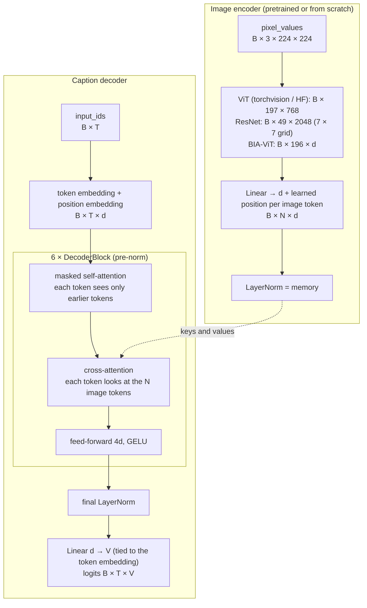
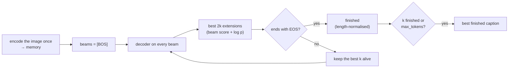

# How the model works

A short tour of the code with tensor shapes. B = batch size, T = number of
caption tokens in the batch, N = number of image tokens, V = vocabulary size
(50 258), d = `d_model` (512).

## 1. Data (`data.py`, `tokenizer.py`)

Default: [Flickr30k](https://huggingface.co/datasets/AnyModal/flickr30k),
Karpathy splits: 29 000 train / 1 014 validation / 1 000 test photos, each
with 5 human captions. Other presets (`shapes`, `flickr8k`, `coco`) and any
Hugging Face dataset go through the same code: see [datasets.md](datasets.md).
Captions can come as one list column, several string columns, or one caption
per row grouped by an image id (COCO).

**One item per image.** During training each image comes with a *random* one
of its captions, so an epoch encodes every image once while all captions
still get used over the epochs. Validation always uses the first caption, so
the loss is comparable from one evaluation to the next; BLEU compares with all
five.

**Image** → training: random crop of 75–100% of the area resized to 224×224,
mild colour jitter; evaluation: resize to 224×224. Then scaled to [0, 1] and
normalised with the ImageNet mean/std (what the pretrained encoders expect)
→ `[3, 224, 224]`. No horizontal flip: it would make "left" / "right" wrong.

**Caption** → GPT-2 byte-level BPE tokens, wrapped as

```
<|endoftext|>  A dog runs on the grass .  <|endoftext|>   <|pad|> <|pad|> ...
    (BOS)            the caption              (EOS)         padding
```

GPT-2 has no padding token, and the common shortcut "pad = EOS" is a trap:
the loss ignores padding, so it would also ignore EOS and the model would
never learn to stop. A dedicated `<|pad|>` token is added instead.
Captions average 16 tokens; `max_tokens = 64` fits 99.96% of them.

**Batching** (`CaptionCollator`) pads each batch only to its longest caption
(dynamic padding) and builds `labels` = `input_ids` with padding replaced by
-100, the value PyTorch's cross-entropy skips.

```
pixel_values [B, 3, 224, 224]   input_ids [B, T]   labels [B, T]   index [B]
```

## 2. Model (`model.py`)



### The encoders

Every encoder returns a sequence of image tokens `[B, N, C]`; a linear layer
maps C to d. All of them except BIA-ViT can start from pretrained weights or
from scratch (`--from-scratch`).

| `--encoder` | Pretrained on | Image tokens (224 px) | Encoder params |
|---|---|---|---|
| `bia-vit` | (always from scratch) | 196 × d (14 × 14 patches) | 19.4M (6 layers, d = 512) |
| `vit_b_16` (default) | ImageNet-1k | 197 × 768 (196 patches + class token) | 85.8M |
| `vit_b_32` / `vit_l_16` / `vit_l_32` / `vit_h_14` | ImageNet-1k (`vit_h_14`: SWAG, 518 px) | 50 × 768 / 197 × 1024 / 50 × 1024 / 1370 × 1280 | 87.5M / 303M / 306M / 632M |
| `resnet18` / `resnet34` | ImageNet-1k | 49 × 512 (7 × 7 grid) | 11.2M / 21.3M |
| `resnet50` / `resnet101` / `resnet152` | ImageNet-1k | 49 × 2048 | 23.5M / 42.5M / 58.1M |
| `hf:<model id>` | that checkpoint (ImageNet-21k, DINOv2, CLIP, SigLIP, ...) | the model's last hidden states | depends |

How each one is turned into tokens (`model.py`):

- **torchvision ViT**: patch embedding + class token + the Transformer
  encoder; the classifier head is dropped and *all* tokens are kept.
- **torchvision ResNet**: everything up to the last convolutional stage; the
  pooling and classifier are dropped and each cell of the 7 × 7 grid is a token.
- **Hugging Face**: `AutoModel` (for CLIP / SigLIP only the image tower);
  its `last_hidden_state` are the tokens (a 4-D convolutional output is
  flattened like a ResNet grid). ViT-style models interpolate their position
  encodings at other image sizes. Parameters that never reach the tokens
  (poolers, projection heads) are found with one probe pass and frozen, so
  multi-GPU training does not wait for gradients that never come.
- **BIA-ViT** is the project's own Vision Transformer: 16 × 16 patches embedded
  by a strided convolution, a learned position per patch, pre-norm Transformer
  blocks (the same `MultiHeadAttention` / `FeedForward` modules as the decoder)
  and a final LayerNorm.

Inputs are normalised the way the encoder was trained: ImageNet mean / std for
torchvision models and BIA-ViT, the Hugging Face image processor's values for
`hf:` models (CLIP, for example, uses different statistics). The values are
stored in the checkpoint, so inference always matches training.

**Pretrained vs from scratch.** On 29k photos a pretrained encoder captions far
better: a ViT trained from scratch has no built-in notion of locality and
needs very large datasets to learn it; a ResNet from scratch does somewhat
better thanks to its convolutions but is still far from ImageNet features. On
the synthetic `shapes` data an encoder trained from scratch does learn the
task (see testing.md), which makes it a good test of the architecture itself.

### Design choices, and why

- **All image tokens + cross-attention**, not one image vector: the decoder can
  look at different regions for different words ("dog" vs "frisbee").
- **Learned position on image tokens** (added after the projection): attention
  ignores order, so the decoder needs to know where each token comes from.
- **Normalised memory**: the projection is followed by a LayerNorm so the
  cross-attention keys and values have a controlled scale whatever the encoder.
- **Pre-norm blocks** (LayerNorm before each sub-layer) train more stably; they
  need the extra final LayerNorm.
- **Fused attention**: `F.scaled_dot_product_attention` uses FlashAttention /
  memory-efficient kernels on GPU. The causal mask also covers right padding:
  real tokens only look back, and padding always comes after them.
- **Weight tying** of the token embedding and output layer: saves V × d =
  25.7M parameters and usually gives a better language model.
- **GPT-2 style init**: new weights ~ N(0, 0.02), residual output projections
  scaled by 1/√(2 · layers); a pretrained encoder keeps its weights.
- Default size with `vit_b_16`: 137M parameters (encoder 86M, decoder 52M,
  of which 26M is the shared embedding).

## 3. Loss

Teacher forcing: the model reads the true caption and, at each position t,
predicts token t+1.

```python
loss = cross_entropy(logits[:, :-1], labels[:, 1:], ignore_index=-100, label_smoothing=0.1)
```

Padding positions are -100, so they do not count. Label smoothing (0.1) keeps
the model from becoming over-confident on a small dataset.

## 4. Generation

**Greedy / sampling** (`model.generate`, batched): encode the images once,
start every row with BOS, then repeatedly run the decoder, take the last
position's logits and pick a token (argmax, or sample with temperature /
top-k / top-p), until every row has produced EOS or `max_tokens` is reached.

**Beam search** (`model.beam_search`, one image): keep the `beam_size` most
likely partial captions. At each step every beam is extended by every token,
the 2 × `beam_size` best candidates are kept, the ones ending in EOS are set
aside as finished and the best `beam_size` others continue. Finished captions
are ranked by log-probability / ((5 + length) / 6)^α (GNMT length penalty,
α = 0.6), so short captions are not unfairly favoured.



Pad and BOS are never generated. The decoder is re-run on the whole prefix at
each step (no KV cache): simple, and fast enough for 16-token captions.

## 5. Optimisation (`train.py`)

- **AdamW**, betas (0.9, 0.98). Two learning rates: `--lr` (3e-4) for the
  decoder, `--encoder-lr` for the encoder (default 1e-5 for a pretrained
  encoder, equal to `--lr` for BIA-ViT). `--freeze-encoder` trains only the
  decoder; the frozen encoder runs without autograd and stays in eval mode.
- **No weight decay** on biases, LayerNorms, embeddings and position / class
  tokens.
- **LR schedule**: linear warmup (500 steps), then cosine decay to 0.
- **Gradient clipping** at norm 1, after un-scaling.
- **Mixed precision**: bf16 autocast (or fp16 + GradScaler on older GPUs).
- **Gradient accumulation** to reach large effective batches on small GPUs.
- **DDP** for several GPUs / machines.
- **Validation**: token-weighted loss, perplexity, token accuracy, plus
  corpus BLEU-1..4 of greedy captions on `--bleu-samples` images.
