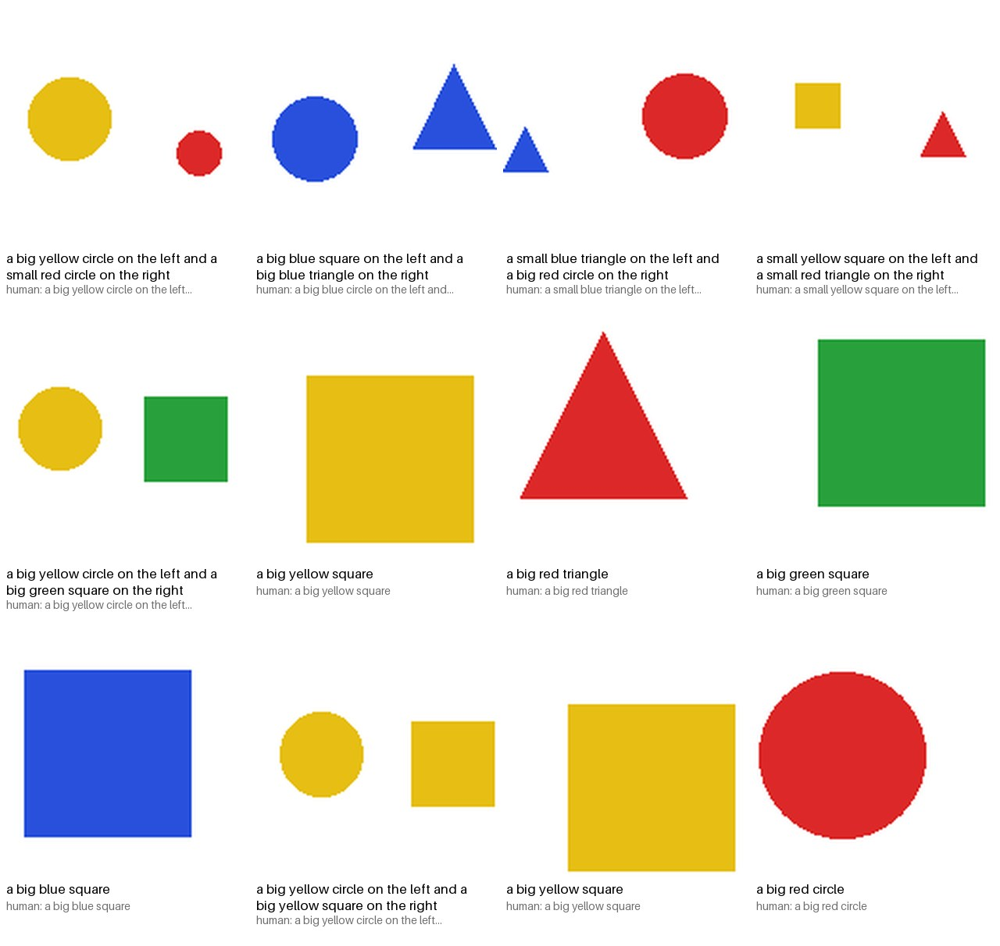

# Testing guide

Five levels of checks, from seconds to an hour:

1. **Unit tests and sanity checks** (`pytest`): every module, CPU only, no network.
2. **Synthetic shapes**: does the architecture learn to read images? (laptop CPU)
3. **Flowers**: does it caption real photos well after a short training? (laptop CPU)
4. **Overfit check on real photos**: can the model memorise 8 Flickr30k images?
5. **Launch checks**: the real CLIs (`cap-train`, `cap-generate`, `cap-evaluate`,
   `torchrun`), the notebook and the web app.

## 1. Unit tests and sanity checks

```bash
pytest                       # everything (~3 min on a laptop CPU)
pytest --cov=bia_captioner   # with line coverage
pytest tests/test_model.py   # one file
pytest -k beam -v            # tests whose name contains "beam"
ruff check src tests         # lint
ruff format --check src tests
```

No GPU and no internet needed: tests use tiny fake datasets, a tiny tokenizer,
small models and randomly initialised encoders.
The web-app tests run when the app extra is installed
(`pip install -e '.[dev,app]'`) and are skipped otherwise.

### The neural-network sanity checks

The usual checklist for "is this network wired correctly?", each one an
automated test:

| Check | Why it matters | Test |
|---|---|---|
| Initial loss ≈ ln(vocabulary) | a random model must be a uniform guesser; much higher means bad init / scaling | `test_initial_loss_is_close_to_random_guessing` |
| Numerical gradient check | backprop agrees with finite differences for attention, encoder and decoder blocks (float64 `gradcheck`) | `test_analytic_gradients_match_numerical_gradients` |
| Activation scale through depth | with 8 encoder + 8 decoder layers the residual stream neither explodes nor vanishes at init | `test_activations_keep_their_scale_through_depth_at_init` |
| Overfit one batch | if it cannot memorise 2 captions, the loss, masks or optimiser are broken | `test_can_overfit_one_batch` |
| Every trainable parameter gets a gradient (each encoder family) | dead layers waste compute and crash DDP | `test_every_trainable_parameter_receives_a_gradient` |
| One optimizer step changes every trainable parameter, and no frozen one | no parameter forgotten in the optimizer groups; freezing really freezes | `test_one_optimizer_step_updates_every_trainable_parameter` |
| No look-ahead | future tokens must not change past predictions (causal mask) | `test_causal_future_tokens_do_not_change_past_logits` |
| Padding is invisible | pads must not change real tokens' outputs or the loss | `test_padding_does_not_change_real_token_logits`, `test_loss_is_finite_and_ignores_minus_100` |
| Samples are independent | a reshape mixing batch and time axes, or BatchNorm in train mode, leaks across samples | `test_samples_in_a_batch_do_not_influence_each_other` |
| The image reaches the output | otherwise it is a language model, not a captioner | `test_the_image_changes_the_prediction`; on data: `cap-evaluate --shuffle-images` |
| Eval mode is deterministic | dropout must be off at inference | `test_eval_mode_is_deterministic_and_train_mode_uses_dropout` |
| Mixed precision is stable | bf16 loss finite and close to fp32 | `test_bf16_autocast_gives_finite_loss_close_to_fp32` |
| Gradient accumulation = one big batch | the legacy bug: same weights after 2×4 accumulated as after 1×8 | `test_gradient_accumulation_matches_one_big_batch` |
| Same seed = same run | needed to compare experiments | `test_same_seed_gives_the_same_run` |
| LR schedule | warmup and cosine values | `test_lr_lambda_*` |
| Resume | a restarted run continues the step count and data order | `test_resume_continues_step_count` |
| Multi-process | 2 DDP processes end with identical weights | `test_two_process_training_stays_in_sync` |
| Memorise, then reproduce through the CLIs | `cap-train` memorises 8 images; `cap-generate` (beam and greedy) returns their exact captions from PNG files | `test_cap_generate_reproduces_a_memorised_caption` |
| Data → tokens → text round trip | a caption encodes to `<bos> … <eos>` and decodes back to the same text | `test_encode_caption_round_trips` |

### What each file proves

| File | What it proves |
|------|----------------|
| `test_tokenizer.py` | a dedicated pad token is added (pad ≠ EOS), BOS = EOS like GPT-2, captions round-trip, -100 labels are skipped by the loss |
| `test_cli.py` | **end to end through the real commands**, offline: `cap-train` on shapes writes a complete run and lowers the loss; `cap-generate` reproduces memorised captions; `cap-evaluate` scores the test split and draws a gallery; `--overfit` memorises |
| `test_app_and_notebook.py` | the notebook embeds exactly the current `src/` code and the committed notebook is up to date; every notebook cell is valid Python; the web app captions with beam search, greedy and sampling and reports a missing checkpoint |
| `test_config.py` | invalid settings are rejected early (pad = EOS, unknown encoder, bad precision); every encoder name and dataset preset is valid; BIA-ViT is never "pretrained"; the encoder LR is 1e-5 when pretrained and the decoder LR when from scratch |
| `test_data.py` | images become normalised `[3,H,W]` tensors (with the encoder's own mean / std); captions become `<bos> … <eos>`; truncation drops EOS; validation uses the first caption, training samples all of them; captions from one list column, several columns, or **one per row grouped by image id (COCO)**; the synthetic shapes are deterministic, differ between splits, and every color named in a caption is in the picture; the collator pads with -100 labels and does not shift them |
| `test_metrics.py` | BLEU: perfect = 1, no overlap = 0, clipping, brevity penalty, a hand-computed BLEU-4 (also matches NLTK); exact match ignores case / punctuation |
| `test_model.py` | the sanity checks above; shapes for **each encoder family** (BIA-ViT, torchvision ViT, torchvision ResNet, Hugging Face ViT); **`pretrained` decides which weights are loaded** (and a checkpoint load never downloads); pretrained torchvision ViTs reject a wrong image size; the Hugging Face encoder interpolates positions, finds and freezes its unused pooler; greedy / top-k / top-p generation; **beam search finds a sequence greedy misses**, equals greedy with beam 1; weight-decay groups; a **frozen encoder** gets no gradient and stays in eval mode |
| `test_train.py` | LR schedule, precision / device selection, CLI flags and dataset presets reach the configs, `--from-scratch`, encoder LR defaults; a training run lowers the loss and writes `last.pt` / `best.pt` / `tokenizer/`; resume; gradient accumulation; reproducibility; the real model + collator train end to end, with and without a frozen encoder; BLEU ~1 on a memorised set; the callback receives train / validation metrics |
| `test_distributed.py` | **DDP**: 2 processes (gloo on CPU) start from *different* weights, train with gradient accumulation and end **identical**; only rank 0 writes checkpoints |
| `test_generate.py` | a checkpoint reloads into exactly the same model; `cap-generate` with beam search, greedy and sampling; `cap-evaluate` writes scores and predictions, and runs with `--shuffle-images` |

## 2. Synthetic shapes: does the architecture read images?

Synthetic images of colored shapes whose caption is fully determined by the
picture (see [datasets.md](datasets.md#1-shapes-the-simplest-proof-the-architecture-works)).
The question: does the model caption **unseen** images from their pixels, or
only produce plausible-sounding captions?

```bash
cap-train --dataset shapes --encoder bia-vit --image-size 64 --patch-size 8 \
          --d-model 128 --heads 4 --layers 2 --encoder-layers 3 \
          --epochs 8 --lr 1e-3 --warmup-steps 100 --eval-every 250 --bleu-samples 200 \
          --output-dir checkpoints/shapes
cap-evaluate --checkpoint checkpoints/shapes/best.pt --split test --beam-size 1
cap-evaluate --checkpoint checkpoints/shapes/best.pt --split test --beam-size 1 --shuffle-images
```

Real run on a laptop CPU: **BIA-ViT trained from scratch** (7.6M parameters
in total, 0.6M in the encoder), the full 8 epochs = 1 000 optimizer steps
(~1 h 50 on a CPU shared with other jobs; it was paused at step 250 and
continued with `--resume`):

| step | train loss | val loss | val token acc | val BLEU-4 |
|-----:|-----------:|---------:|--------------:|-----------:|
| 250  | 1.60       | 0.274    | 0.913         | 0.668 |
| 500  | 1.53       | 0.186    | 0.952         | 0.856 |
| 750  | 1.48       | 0.128    | 0.976         | 0.940 |
| 1000 | 1.45       | **0.108**| **0.986**     | **0.962** |

(Training loss includes label smoothing 0.1, so it cannot reach 0.)

Test split (500 images never seen in training), greedy decoding:

| | BLEU-1 | BLEU-4 | exact caption |
|---|---:|---:|---:|
| real images | 98.2 | **95.5** | **88.0%** |
| images shuffled (`--shuffle-images`, the control) | 49.1 | 26.3 | 1.2% |
| *(same model after only 2 epochs, real images)* | *84.1* | *67.3* | *43.2%* |

The control is what proves the architecture works: given the *wrong* image
(a fixed random permutation of the test split) the same model drops from 88%
exact captions to 1.2%, so its captions come from the pixels, not from a
memorised language pattern. The remaining BLEU of the control is the language
prior (every caption starts "a small/big ... on the left and ...").



Colors, sizes, counts and left / right are almost always right. Of the 60
wrong captions, 58 differ by one shape word, mostly a small circle called a
square (47 times): at 64 px with 8 px patches a small circle is a few
blocky pixels. Train longer or use `--image-size 96` / `--patch-size 4` to
remove most of those.

```
target:     a small green square on the left and a small blue circle on the right
prediction: a small green square on the left and a small blue square on the right
```

## 3. Flowers: real photos, quick results

The "CIFAR-10 of captioning" ([datasets.md](datasets.md#2-flowers-the-cifar-10-of-captioning)):
6 552 flower photos with one short caption each.

```bash
cap-train --dataset flowers --encoder resnet50 --freeze-encoder \
          --d-model 256 --heads 4 --layers 3 --epochs 4 --batch-size 32 --lr 5e-4 \
          --warmup-steps 100 --eval-every 184 --bleu-samples 200 --output-dir checkpoints/flowers
cap-evaluate --checkpoint checkpoints/flowers/best.pt --split test --gallery flowers.png
```

Real run on a laptop CPU: ImageNet-pretrained ResNet-50 **frozen** (so only
the 16.6M-parameter decoder trains), 4 epochs = 696 steps, ~75 minutes (the
CPU was shared with other jobs). On a GPU, fine-tuning a ViT for more epochs
should do better; that has not been run yet.

| step | val loss | val token acc | val BLEU-4 (greedy, 200 images) |
|-----:|---------:|--------------:|--------------------------------:|
| 184  | 1.48     | 0.696         | 0.25 |
| 368  | 0.86     | 0.785         | 0.35 |
| 552  | 0.71     | 0.819         | 0.43 |
| 696  | **0.69** | 0.826         | **0.44** |

Test split (655 photos never used for training or model selection):

| decoding | BLEU-1 | BLEU-4 | exact caption |
|---|---:|---:|---:|
| beam search (3) | 61.0 | 45.6 | 23.1% |
| greedy | 65.4 | **47.7** | 19.9% |

The test photos with their generated captions (`--gallery`, picks spread over
the whole split):


The model names the species (petunia, thorn apple, dahlia, primula, gazania,
gentian, foxglove, ...) and notices details such as a bee on the flower; it
still makes small language slips ("a bee on a bee"). The captions it learned
from were themselves written by the BLIP model, so these scores measure how
well it reproduces that captioner, not human judgement.

Not run yet: the `--shuffle-images` control on flowers (the run was stopped
when the laptop ran out of memory).

## 4. Overfit sanity check (real photos)

The single most useful test of a training pipeline: if the model cannot
memorise a handful of images, something is broken (labels shifted twice,
masks wrong, encoder disconnected, LR far off, ...).

```bash
cap-train --overfit 8 --encoder vit_b_16 --epochs 60 --batch-size 8 --lr 1e-3 \
          --warmup-steps 5 --eval-every 20 --log-every 5 --output-dir checkpoints/overfit
```

Result on a laptop CPU (no GPU), real Flickr30k images, pretrained ViT-B/16
fine-tuned (137.3M parameters), ~16 minutes:

| step | train loss | val loss | val token acc | val BLEU-4 |
|-----:|-----------:|---------:|--------------:|-----------:|
| 5    | 9.25       |          |               |            |
| 20   | 1.81       | 1.20     | 0.796         | 0.27       |
| 40   | 0.044      | 0.028    | 1.000         | **1.00**   |
| 60   | 0.013      | **0.012** (perplexity 1.01) | 1.000 | 1.00 |

```
sample target:     A group of people stand in the back of a truck filled with cotton.
sample prediction: A group of people stand in the back of a truck filled with cotton.
```

Reloading `best.pt` in a fresh process, `cap-generate` (beam size 3)
reproduced the captions of the training images word for word, and
`cap-evaluate` on those 8 images gave BLEU-1..4 = 100.

What this does **not** tell you: how well the model captions *new* photos.
That needs a full GPU run and the test-split BLEU (`cap-evaluate`).

## 5. Launch checks

```bash
# training CLI, exit code must be 0 (the small BIA-ViT is fast on CPU)
cap-train --overfit 8 --encoder bia-vit --epochs 3 --batch-size 8 \
          --d-model 128 --heads 4 --layers 2 --encoder-layers 2 --output-dir /tmp/cap-check ; echo $?

# 2 processes on one machine (CPU uses the gloo backend, GPUs use NCCL)
torchrun --standalone --nproc_per_node=2 -m bia_captioner.train \
    --overfit 16 --encoder bia-vit --batch-size 4 --grad-accum 2 \
    --d-model 128 --heads 4 --layers 2 --encoder-layers 2 --epochs 6 --eval-every 3 \
    --output-dir /tmp/cap-ddp

# resume it for 2 more epochs: the log must say "resumed ... at step 6"
torchrun --standalone --nproc_per_node=2 -m bia_captioner.train \
    --overfit 16 --encoder bia-vit --batch-size 4 --grad-accum 2 \
    --d-model 128 --heads 4 --layers 2 --encoder-layers 2 --epochs 8 --eval-every 3 \
    --output-dir /tmp/cap-ddp --resume /tmp/cap-ddp/last.pt

# inference and evaluation
cap-generate --checkpoint checkpoints/overfit/best.pt --image photo.jpg
cap-evaluate --checkpoint checkpoints/overfit/best.pt --split train --limit 8
```

What to check in the output:

- the first line prints the **effective batch** and the encoder, e.g.
  `effective batch 16 = 4 per process x 2 accum x 2 processes ... encoder=bia-vit`;
- only **one** process prints INFO lines (rank 0);
- the loss goes down; the run ends with `done | best val loss ...`;
- `last.pt`, `best.pt` and `tokenizer/` exist in the output directory.

**The notebook** was executed end to end with `nbclient` in `SMOKE_TEST`
mode (ResNet-50, 64 images, small decoder) on real Flickr30k images: every
cell ran, including training with the live dashboard, beam-search captions,
test BLEU and the final zip.

## Not tested yet

- Real GPUs (CUDA, bf16/fp16, NCCL, fused AdamW) and a real multi-machine
  cluster. The code paths are standard PyTorch, but do a short run (or the
  notebook with `SMOKE_TEST = True`) on the GPU before a long job.
- Caption quality on unseen photos after a full training run.
